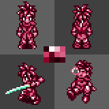
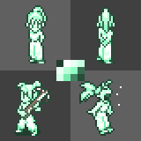
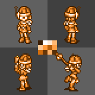
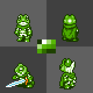
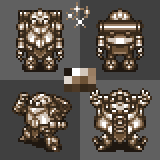
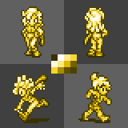
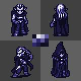

## Color Aspects by JCollins2048
It's the *Chrono Trigger* gang, but their most noteworthy colors become their *only* colors.

### Preview
<div align="center">
     <br>  
</div>

### Palette Codes
```
   Brick Red Crono: #2C000D#FFFFFF#EAAFC1#D14D75#CD3D68#5D001C#D14D75#D76386#8D002A#3E0013#28000C#440015
  Mint Bliss Marle: #203E2E#FFFFFF#E8FFF3#C7FFE1#EBFFF4#BBFFDA#91FFC4#386C50#D5FFE8#7AECAF#448462#274C38
      Orange Lucca: #3C1F04#FFFFFF#FFE9D4#FFB772#FFC792#FF9A3A#B45D0B#FF9F45#D26D0D#683607#FFB269#5A2F06
    Inch Worm Frog: #173300#FFFFFF#9FD671#57B707#ABDB83#57B707#4BA600#449500#4CA800#306A00#1D4000#1E4100
       Shadow Robo: #1F1710#FFFFFF#D3C7BB#997D62#E0D8D0#937659#6D5236#9E8369#423221#4D3926#35281A#3C2D1E
      Sunglow Ayla: #3A3000#FFFFFF#FBE98F#F9D731#FEF9DF#FBE887#DDB800#746100#F8D525#A78B00#615100#4D4100
Royal Purple Magus: #0D0C1F#E9E8F1#B6B3D2#5D579B#706AA6#2E286C#615A9D#1B173F#2D2769#1E1A46#0D0C1F#110F28
```