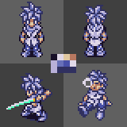
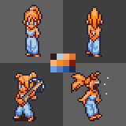
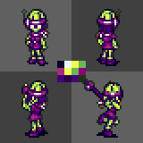
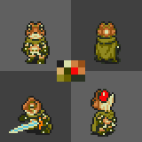
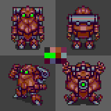
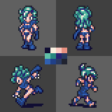
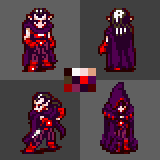
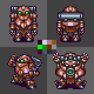
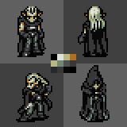

## Castlevania: Sonata of Temporal Discordance
Take on the aspects of various noteworthy figures from vampire legends.

### Preview
<div align="center">
     <br>  
</div>

### Palette Codes
```
       Crono as Soma Cruz: #181028#E0D8E8#E0C8A0#B87860#B8B0D8#6870B8#4850A8#E0D8E8#B8B0D8#303060#303060#303060
 Marle as Sypha Fernandez: #331B11#B0D0E0#F8B078#E07830#F8B078#F89018#E07830#841800#68A0E8#5878C0#2058A8#202848
         Lucca as Lerajie: #0C0024#E7F7FF#EFFF4D#6DB655#A62C7D#EFFF4D#6DB655#8E0075#450075#2C004C#450075#1E3317
Frog as "Treffie" Belmont: #1E1E1E#D8E0A8#D08040#985018#D8B068#384000#F80808#D08040#908820#686000#293121#293121
            Robo as Golem: #282828#B87878#985028#782850#00F800#00F800#782800#789898#500028#505078#280028#500028
       Ayla as Persephone: #110E33#F8F0E0#F8C8C0#E89080#60C0A8#288880#282070#283960#3060B0#204088#283960#202330
         Magus as Dracula: #260000#F8F8F8#F8D8D8#E0A080#483820#280028#F80000#500050#980000#842152#280028#4C0000
```

## Alternate Palettes
### Crono as Johanthan Morris


`#1C152B#E0E0E0#F3CFAC#F39B61#FCD893#F39B61#594969#F31C23#A41C0F#691C08#4C3934#232323`

### Robo as Golem (Metallic)


`#280028#D0D0F2#B87878#985028#00F800#009900#782800#789898#500028#505078#282828#4A3142`

### Magus as "Alucard" Tepes


`#000000#E0E0E0#B8B880#B07020#B8B880#708878#505050#383838#282830#383838#080808#000000`