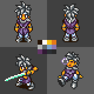
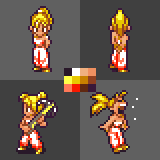
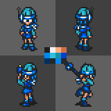
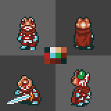
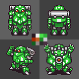
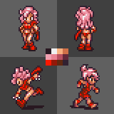
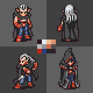
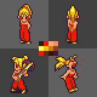
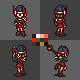
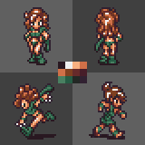

## We Are Rockman 1 by JCollins2048
Sizzling circuits! Dr. Wily's latest scheme could destroy time, itself! Quick — to the DeLorean! (Er, wait…)

### Preview
<div align="center">
     <br>  
</div>

### Palette Codes
```
Crono as Blade Man: #261404#FFFAF5#F4C218#E47919#B2B4B3#5B6468#7CA4CC#8D76AE#623566#301A33#2B2F33#282828
     Marle as Roll: #291829#FFFFFF#F0B080#F09060#FFFF4A#E8C800#C88000#904020#FF7858#F81800#602810#391839
 Lucca as Mega Man: #1E1E1E#F0F0F0#F8B080#D07048#0088F0#30C0D8#1890A8#0040D0#003060#282828#0088F0#282828
 Frog as Sword Man: #103030#E4E4E4#E4B484#C46040#C42020#60C4D4#209440#702010#943020#702010#502020#0D2626
      Robo as Auto: #291821#F0F0F0#48E048#30B038#A82800#C06028#208828#C8C8D0#106020#988888#303030#4A3142
      Ayla as Plum: #291821#F0F0F0#F8B080#D07048#F0A0B0#E88090#B85060#632939#FA1800#941808#612810#312131
 Magus as Dr. Wily: #291821#E2EAF2#EABA91#DA9171#BABABA#919191#CA6950#505050#BA2818#284081#262626#312129
```

## Alternate Palettes
### Marle as Roll (Alt)


`#291829#F81800#F0B080#F09060#FFFF4A#E8C800#C88000#904020#F81800#602810#331508#391839`

### Lucca as Kalinka


`#291821#FFFFFF#F8B080#D27148#F81800#505068#303040#941808#602810#202020#C88000#190A04`

### Ayla as Quake Woman (Archie Comics)


`#291821#F0F0F0#F8B080#D07048#D07048#804020#662A2A#471D29#498061#265C44#232824#312131`