# J. Collins' FFMQ Randomizer Mods

Various odds and ends for use with the wildham0's *[FFMQ Randomizer](https://github.com/wildham0/FFMQRando)*.

*(Last updated 11/03/2026)*

## Player Skins (`customsprites`)
- Find the **Custom Player Sprite** menu under **Preferences**
- Select **Upload Custom Sprites**, then load up any of the `.BMP` files you see in the `spritesheets` directory
    - You can ignore the `icons` directory and `metadata.yml` file. Those are for recompilation purposes.
- Make whatever other changes to your generation, then generate your modded game

### Sumo (*Final Fantasy Adventure*)
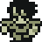 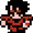 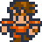

### Diviner (*Final Fantasy Legend III*)
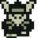 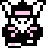 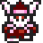

### Mega Man (*Mega Man*)
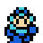 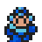

### Roll (*Mega Man*)
#### *Mega Man*
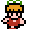 

#### *Mega Man 8*
 

#### *Mega Man 11*
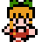 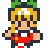

### Proto Man (*Mega Man 3*)
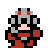 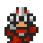

### Bass (*Mega Man 7*)
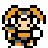 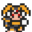